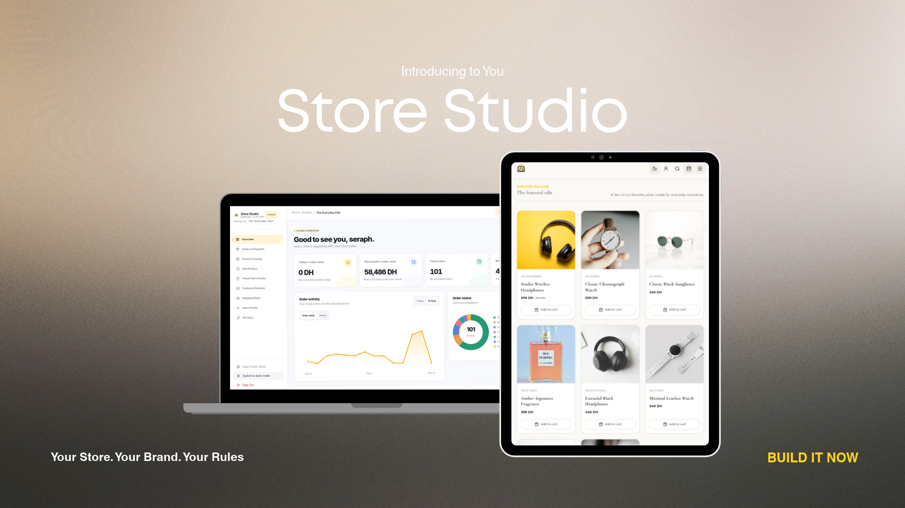

  <picture>
    <source media="(prefers-color-scheme: dark)" srcset="client/public/store-studio-logo-light.svg">
    
  </picture>

  # Store Studio

  **Your store. Your style. Your rules.**

  A free, open-source e-commerce platform you can customize and host yourself.  
  **One installation. One store. Full control.**

  [Explore features](#what-you-can-do) · [Getting started](#getting-started) · [Screenshots](#screenshots) · [Developer guide](DEV_README.md)

---

## Make it yours

Store Studio gives independent sellers a ready-to-customize online shop, without requiring a hosted store-building subscription. Install it on your own server, create an owner account, design your storefront, add products, and start accepting order requests.

Every installation belongs to **one business**. Customers see *your* storefront, not a marketplace or the Store Studio promotional page. The owner and authorized staff manage everything behind a private dashboard.

## What you can do

| Beautiful storefront | Store management |
|:--|:--|
| Choose **Minimal, Modern, or Editorial** layouts | Manage products, categories, inventory and pricing |
| Customize logos, colors, fonts, hero imagery and sections | Upload product photos, videos and storefront media |
| Keep edits for each template when switching between designs | Crop, zoom and reposition product images |
| Browse on desktop, tablet and mobile | Manage orders and shipping rules |
| Search and filter the catalog; use a shopping cart | Moderate customer reviews and configure your store |
| Feature collections and selected products | View order activity and dashboard summaries |

### Flexible checkout

Sellers can choose payment terms **for each product**:

- **Cash on delivery (COD):** pay on delivery.
- **Deposit + COD:** pay a specified percentage before dispatch and the balance on delivery.
- **Full prepayment:** payment required before dispatch.

**Important:** Store Studio does **not** collect online payments. Checkout submits an **order request**; any required advance is arranged outside the platform and manually marked as received by the seller. Don't present an order request as an already-paid order.

### Your brand, not ours

Start with the included generic branding or upload your own logos, colors, and media. The optional ring-size guide is off by default, so it won't appear in stores that don't sell rings. Each template keeps its own visual configuration.

## Getting started

1. **Download or clone** this repository onto the server where your shop will run.
2. **Configure** your private `.env` file and create installation credentials.
3. **Start** the application and open its setup wizard.
4. **Create your owner account**, choose your design, and publish.
5. **Add your products**, configure delivery/payment terms, and start taking orders.

For exact prerequisites, commands, configuration values, and production precautions, follow the **[Developer & deployment guide](DEV_README.md)** and **[Installation guide](INSTALLATION.md)**.

The application supports an **optional demo storefront** with fictional products, photos, and homepage content. Use it for evaluation only; instructions are in [Demo seeding](docs/DEMO_SEEDING.md).

## Documentation

- [Developer guide: setup, architecture, tooling and deployment](DEV_README.md)
- [Installation and first-time owner setup](INSTALLATION.md)
- [Storefront templates and customization](docs/Storefronts.md)
- [R2 media and image framing](docs/R2_MEDIA_AND_FRAMING.md)
- [Checkout payment policies](docs/PAYMENT_TERMS.md)
- [Optional integrations and API keys](docs/MCP_API_KEYS.md)
- [Contributing](CONTRIBUTING.md) · [Security](SECURITY.md)

## Open source

Store Studio is distributed under the [MIT License](LICENSE). You can adapt it for your own storefront or client projects, subject to the license and any separately licensed third-party assets and dependencies.

Contributions and issues are welcome. Please avoid posting real customer information, credentials, or private store data.
